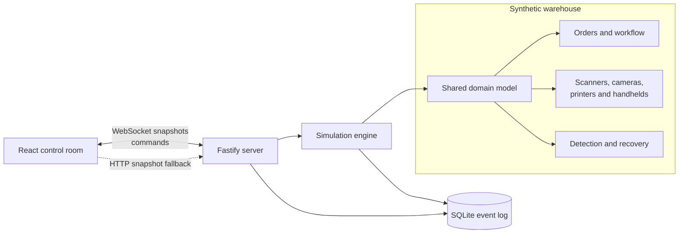

# OpsBridge

[](https://opsbridge-hfr9.onrender.com/)
[](https://github.com/Dansatch/opsbridge/actions/workflows/verify.yml)

OpsBridge is a live warehouse operations simulator. It models orders, industrial
devices, incidents and recovery workflows in one browser-based control room.
There is no account or setup: open the public demo and the warehouse is already
moving.

**[Open the live control room](https://opsbridge-hfr9.onrender.com/)**

## The 30-second tour

1. Follow a parcel through receiving, picking, packing and dispatch.
2. Select a scanner, camera, handheld or printer to inspect its live state.
3. Choose **Cause some trouble** and inject a synthetic equipment fault.
4. Watch OpsBridge detect the fault and open an incident automatically.
5. Acknowledge the incident, apply the suggested recovery and watch work resume.
6. Hand the same operation between day and night shifts without resetting it.

The copy stays clear but conversational: the operational detail is real enough to
be useful, while the label printer is still allowed to produce “modern art”.

## What it demonstrates

- A deterministic TypeScript domain model for orders, devices and incidents
- Fastify HTTP APIs and bidirectional WebSocket commands
- Real-time state shared across every connected control-room view
- SQLite event persistence with bounded history queries
- Failure detection, acknowledgement and fault-specific recovery workflows
- Responsive React UI with contextual detail instead of dashboard overload
- Reliability tests, CI, health checks and graceful process shutdown

All facilities, devices, orders and events are original synthetic data. OpsBridge
contains no customer information, confidential workflows or third-party code.

## Architecture



The server owns the simulation. The React client renders snapshots instead of
duplicating business rules, and sends small typed commands for failure drills,
incident actions and shift changes. Operational events are persisted separately
from the current in-memory demo state.

## Reliability

`pnpm verify` runs formatting, linting, TypeScript checks, 22 Vitest tests and the
production build. The suite includes a 500-tick endurance run, every failure and
recovery drill, partial-operation behaviour during outages, malformed WebSocket
commands and SQLite persistence limits. GitHub Actions runs the same gate on
every push and pull request.

## Run locally

Requires Node.js 22 and Corepack.

```sh
corepack enable
pnpm install
pnpm verify
pnpm start
```

Open `http://localhost:3000`. For development, run `pnpm dev` and open
`http://localhost:5173`.

## Useful endpoints

| Endpoint                   | Purpose                                   |
| -------------------------- | ----------------------------------------- |
| `GET /api/health`          | Lightweight readiness response            |
| `GET /api/simulation`      | Current warehouse snapshot                |
| `GET /api/events?limit=25` | Recent persisted operational events       |
| `WS /api/live`             | Live snapshots and typed control commands |

## Deployment

[`render.yaml`](render.yaml) defines one Render web service. Fastify serves the
compiled React app, HTTP API and WebSocket endpoint from one origin. Pushes to
`main` run CI and deploy automatically.

Render's free filesystem is ephemeral, so SQLite is deliberately treated as a
rebuildable demo event log—not durable customer storage.

## Project notes

I designed OpsBridge to demonstrate how I approach real-time operational systems:
model the domain first, make failures visible, keep recovery explainable and test
the behaviour that matters. I used AI-assisted development to accelerate
implementation and iteration, and I can explain and modify every part of it.

- [Product brief](docs/product.md)
- [75-second demo video plan](docs/demo-video.md)

## Technology

React · TypeScript · Vite · Node.js · Fastify · WebSockets · SQLite · Vitest
